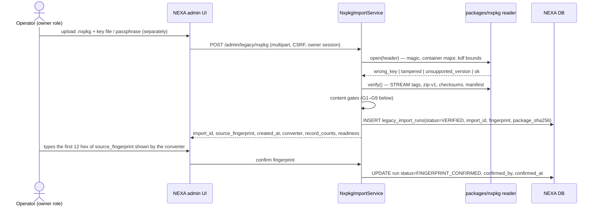
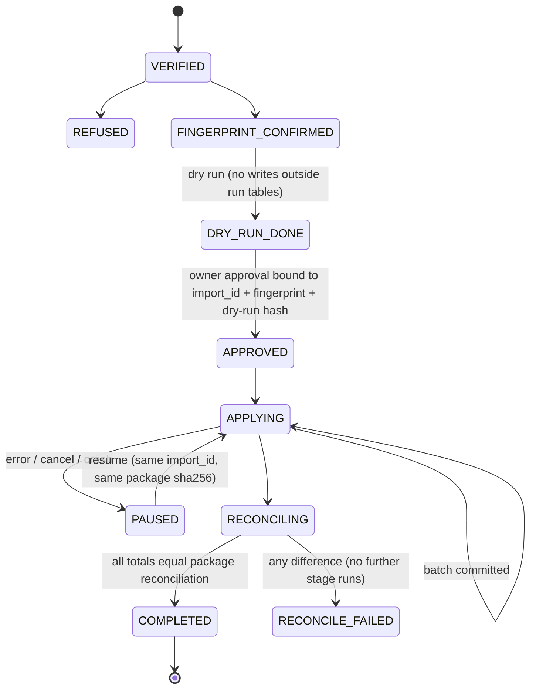

# NEXA `.nxpkg` importer: implementable design

> **Status: design only. Not implemented. `Mhoseinshah1/nexa-bot` has not been changed.**
> Writing any of this in NEXA needs the owner's explicit approval (CLAUDE.md, gate 6). Until an importer
> built from this design passes §15, every manifest keeps `compatibility.verified_by_importer: false` and no
> package may be called "importable in production".
>
> This document supersedes the step lists of [`NEXA_IMPORTER_PLAN.md`](NEXA_IMPORTER_PLAN.md) where the two
> differ. The plan keeps the background, the module-retirement rules (§5) and the Phase-2 destination
> table (§8.1). Content contract: [`PACKAGE_CONTRACT.md`](PACKAGE_CONTRACT.md) (1.4.0). Container and
> trust model: [`NXPKG_FORMAT.md`](NXPKG_FORMAT.md). NEXA code facts: [`NEXA_EVIDENCE.md`](NEXA_EVIDENCE.md)
> (nexa-bot @ `9e604de`).

> **Source snapshot (contract 1.4.0).** The importer NEXA is actually building reads the package through its
> existing `LegacySourceSession` port: `NxpkgLegacySourceConnector` serves `tables()`, `catalogColumns()`,
> `countRows()` and `syntheticMarker()` from `source/catalog.json` and `rows()` / `readSetRows()` from
> `source/tables/{user,invoice,product}.jsonl` (format: `PACKAGE_CONTRACT.md` §"Source snapshot"), so the
> existing `LegacyImporterService` re-decides everything from raw cells. The NEXA-side contract is
> `nexa-bot` [`docs/legacy-migration/nxpkg-importer.md`](https://github.com/Mhoseinshah1/nexa-bot/blob/main/docs/legacy-migration/nxpkg-importer.md);
> where it differs from this design, that document governs the NEXA implementation.

> **How the operator runs it (converter 0.7.0).** The package (`nexa-restore-mirza-<id12>.nxpkg` + `.nxkey`) is
> restored from NEXA's Web Admin «بکاپ و بازیابی ← عملیات بازیابی»: choose file → «بررسی» (key file or passphrase;
> package checks, panel mapping, ownership, dry-run counts, nothing written) → «تأیید بازیابی» (protective backup,
> write freeze, import by the `recovery` process role through the nxpkg migration engine, reconciliation, backup).
> This path is in nexa-bot draft PR #278, which is under review and unreleased; until it is released only a test
> installation restores a package. See `PACKAGE_CONTRACT.md` §"How NEXA consumes the package".

## 0. Principles (each one is tested in §15)

1. **Fail closed.** Anything the importer does not understand (unknown major version, unknown `record_type`,
   a live-state flag set to `true`, a blocker, a total that does not reconcile) stops the run before a write.
2. **Re-decide, don't trust.** The package carries raw cells and the converter's decision. NEXA recomputes
   its own decision and checksum; a disagreement goes to quarantine (or aborts, for checksums).
3. **Only one financial write exists:** one `MIGRATION_OPENING_BALANCE` ledger CREDIT per *new* customer.
   Every other record is inert history or a review proposal. No orders, payments, revenue, debt settlement,
   role activation or panel call is ever produced by an import.
4. **Idempotent by construction.** Every row written has a database-unique key derived from
   `(tenant_id, idempotency_key)`. Repeating a run, or resuming one, cannot double-credit.
5. **Non-definitive ⇒ quarantine.** A record whose outcome is not certain (ambiguous ownership, an existing
   NEXA customer with a balance, a mismatching re-decision) is written to `legacy_import_quarantine` and
   waits for an explicit, audited owner decision. Nothing is guessed.
6. **History is append-only.** Ledger entries are never deleted or edited by the importer; corrections are
   NEXA's normal reversing entries, made by a person.

## 1. Components (NEXA side, all new unless marked)

| Component | Proposed path in `nexa-bot` | Role |
|---|---|---|
| `packages/nxpkg` | `packages/nxpkg/src/*` | TS reader mirroring `NXPKG_FORMAT.md`: header, scrypt/raw-key, HKDF, AES-256-GCM STREAM, zip-v1, `checksums.json`, manifest, `iter_jsonl` with hash re-check |
| `NxpkgSource` | `apps/api/src/modules/platform/legacy-importer/infrastructure/nxpkg-source.ts` | implements the existing `LegacySourceSession` port (`source-port.ts:168-220`) over decrypted records |
| Plan/decide | existing `plan.ts`, `decisions.ts` | re-decision of users, invoices, services |
| `NxpkgImportService` | `…/legacy-importer/application/nxpkg-import.service.ts` | stage machine of §3, batches, run ledger |
| Writers | existing `migration-opening-balance.service.ts`, `legacy-wallet-debts`, `legacy-invoice-archive`, `legacy-service-review`, `legacy-product-review`; new history writers | one writer per target table |
| Admin UI | `apps/web/src/pages/legacy-nxpkg-import.tsx` | upload, fingerprint confirmation, dry-run report, quarantine queue, approvals |
| CLI | `apps/api/src/legacy-import-nxpkg.cli.ts` | same service, for staging rehearsal |

The package and its key are uploaded only to the NEXA admin API over the existing authenticated admin
channel; the decrypted payload lives in a private temp directory removed at the end of the run (success,
failure or cancel). Decrypted records are never logged.

## 2. Package validation



Content gates, in order (any failure ⇒ run `REFUSED`, nothing else written):

| Gate | Rule | Refusal code |
|---|---|---|
| G1 | `package_schema == "nexa.migration.mirza"`, `package_schema_version` major `1` | `NXPKG_UNSUPPORTED_VERSION` |
| G2 | `compatibility.min_importer_version <= importer version` | `NXPKG_IMPORTER_TOO_OLD` |
| G3 | `readiness == "ready"` and `blockers == []` | `NXPKG_NOT_READY` |
| G4 | `money.currency == "IRT"`, `money.rescaled == false`, tenant sales currency IRT | `NXPKG_CURRENCY` |
| G5 | every `record_type` is known to this importer version; unknown files under `records/` are refused, unknown files under `reports/` are ignored | `NXPKG_UNKNOWN_RECORD_TYPE` |
| G6 | no record has a live-state flag (`PACKAGE_CONTRACT.md` list) equal to `true` | `NXPKG_LIVE_FLAG_SET` |
| G7 | every record has `schema`, `idempotency_key` (prefix `legacy:`, unique in package), `provenance.source_fingerprint == manifest.source_fingerprint` | `NXPKG_RECORD_INVALID` |
| G8 | `checksums.files[*].records` equals the lines actually read, per file | `NXPKG_COUNT_MISMATCH` |
| G9 | the same `import_id` already `COMPLETED` for this tenant ⇒ the run becomes a no-op report, not a refusal | `ALREADY_IMPORTED` (info) |

Key handling: the key/passphrase is held only in memory for the `verify()` call and the batch reads, never
stored, never logged, never echoed back. Because AES-GCM is symmetric (`NXPKG_FORMAT.md` §9), the
fingerprint confirmation by a human who saw the converter screen is the origin check; an optional Ed25519
converter signature can be added later without changing this flow.

## 3. Run state machine



`APPROVED` reuses `legacy_cutover_approvals` (existing, `0233`) with `scope = 'NXPKG_IMPORT'` and the
`dry_run_sha256` of the dry-run report: an approval of a different dry run is not valid. Approval and
apply must be different sessions of a user with the `migration.approve` permission (§12).

## 4. Dry run and change simulation report

The dry run executes every stage of §5 against the live DB **inside a transaction that is rolled back**
(per batch), collecting what *would* happen. It writes only `legacy_import_runs` and
`legacy_import_dry_run_items`. Report (`dry-run.json`, hashed, shown in the UI in Persian):

| Section | Content |
|---|---|
| `customers` | `NEW`, `EXISTING_NO_BALANCE`, `EXISTING_WITH_BALANCE_CONFLICT`, `QUARANTINE` counts |
| `ledger` | number of opening CREDITs and their sum (minor units) that would be posted; sum of balances that would be quarantined |
| `debts` | debts to record; already recorded |
| `history` | per file: insert / already present (same checksum) / conflict (same key, different checksum) |
| `services` | `ADOPTION_CANDIDATE`, `QUARANTINE_AMBIGUOUS`, `HISTORY_ONLY`, `PANEL_UNMAPPED` |
| `agents` | profiles archived; role activations: always `0` |
| `quarantine` | per reason code count |
| `reconciliation` | NEXA re-decided totals vs `reports/reconciliation.json`; must be equal, otherwise `APPROVED` is not offered |
| `invariants_before` | ledger sum, orders, payments, revenue, active roles, panel-call counter (must be unchanged after apply) |

## 5. Apply stages (order fixed; each stage is resumable)

| # | Stage | Package input | NEXA target | Unique key |
|---|---|---|---|---|
| 1 | customers | `records/customers.jsonl` | customer (NEW only) + `legacy_import_map` | `(tenant_id, telegram_user_id)` |
| 2 | opening balances | `records/wallet_opening_balances.jsonl` | `wallet_entries` CREDIT `MIGRATION_OPENING_BALANCE` for NEW customers only; conflicts → quarantine (§6) | existing partial unique `(tenant_id, customer_id) WHERE reason='MIGRATION_OPENING_BALANCE'` + reference `legacy:opening:<tg>` |
| 3 | debts | `records/legacy_debts.jsonl` | `legacy_wallet_debts` `PENDING_REVIEW` | `(tenant_id, legacy_user_id)` |
| 4 | wallet difference analysis | `records/wallet_difference_analysis.jsonl` | `legacy_wallet_difference` (read-only evidence for §6 decisions) | `(tenant_id, idempotency_key)` |
| 5 | payment & wallet history | `payments.jsonl`, `wallet_history.jsonl`, `wallet_history_checks.jsonl` | `legacy_payment_history`, `legacy_wallet_transactions`, `legacy_wallet_history_checks` | `(tenant_id, idempotency_key)` |
| 6 | invoices & service history | `invoices.jsonl`, `service_operations.jsonl`, `service_cancellation_requests.jsonl`, `manual_config_inventory.jsonl` | existing `legacy_invoice_archive`; new `legacy_service_operations`, `legacy_cancellation_requests` | `(tenant_id, idempotency_key)` |
| 7 | service candidates + ownership | `services.jsonl`, `service_ownership.jsonl` | existing `legacy_service_candidates` + `legacy_service_ownership` (§8) | `(tenant_id, idempotency_key)` |
| 8 | panel / product mapping inputs | `panel_registry.jsonl`, `panels.jsonl`, `panel_mapping_template.jsonl`, `product_mapping_proposal.jsonl`, `products.jsonl`, `categories*.jsonl` | `legacy_panel_mapping` (§7), `legacy_product_reviews` (existing) | `(tenant_id, idempotency_key)` |
| 9 | tickets & support | `support/*.jsonl` | `legacy_support_threads`, `legacy_support_messages` (closed, read-only) | `(tenant_id, idempotency_key)` |
| 10 | agents | `agents/*.jsonl` incl. `agents/state.jsonl` | `legacy_agent_profiles`, `legacy_agent_price_levels`, `legacy_agent_history`, `legacy_agent_state` | `(tenant_id, idempotency_key)` |
| 11 | engagement, archive | `engagement/*.jsonl`, `archive/*.jsonl` | `legacy_discount_history`, `legacy_referrals`, `legacy_wheel_results`, `legacy_raw_archive` | `(tenant_id, idempotency_key)` |
| 12 | review queue | `reports/review-queue.jsonl`, `reports/review-taxonomy.json` | `legacy_import_map` `MANUAL_REVIEW` rows + quarantine | `(tenant_id, source_table, source_pk, code)` |
| 13 | reconcile | `reports/reconciliation.json`, `reports/coverage.json`, `reports/migration-readiness.json` | `legacy_import_reconciliation` | `(run_id, section, metric)` |

`records/configuration/*.jsonl` is **not imported**: operators read it to configure NEXA by hand.

History conflict rule (stages 4–11): same `idempotency_key` with the same `provenance.row_checksum` ⇒ skip
(`ALREADY_PRESENT`); same key with a different checksum (a later backup changed history) ⇒ the existing row
is **not** overwritten, the new version goes to quarantine `HISTORY_CHANGED`.

## 6. Existing NEXA customers and opening balances

A customer record is *existing* when `(tenant_id, telegram_user_id)` already exists in NEXA and was not
created by an earlier run of the same installation (`legacy_import_map` has no row for it).

Current NEXA behaviour is **additive** for existing customers (`docs/migration-opening-balance.md:8-27`,
`NEXA_EVIDENCE.md` §3). This design proposes changing the default because an additive credit to a customer
who already has a NEXA wallet cannot be told apart from double crediting (the same person may have topped
up in both bots, or been migrated by hand).

| Option | Effect | Risk |
|---|---|---|
| A. Additive credit (current NEXA) | post the Mirza balance on top of the NEXA balance | double credit if the balance was already moved by hand; irreversible without a reversing entry |
| B. Replace | set NEXA balance to the Mirza value | destroys NEXA-side history; **never allowed** (ledger is append-only) |
| C. Skip | no credit; customer keeps NEXA balance | silently loses the Mirza balance |
| D. **Quarantine + owner decision (recommended default)** | no ledger write; one `legacy_import_quarantine` row `EXISTING_CUSTOMER_BALANCE` with both balances, the wallet-difference analysis and the history sums | none automatic; needs an owner action |
| E. Credit difference | post `max(0, mirza - already_migrated_for_this_customer)` | only meaningful when NEXA can prove the earlier manual migration amount; not offered by default |

Owner decision (explicit, per quarantined customer or as a reviewed batch, audited): `CREDIT_FULL`
(→ option A for that customer, one `MIGRATION_OPENING_BALANCE` entry with reference
`legacy:opening:<tg>`), `CREDIT_AMOUNT` (an amount ≤ Mirza balance, reason text required), or
`NO_CREDIT` (reason text required). The decision row stores `decided_by`, `decided_at`, `reason`, the
package `import_id` and the balances as shown. A zero Mirza balance never creates a quarantine row.
Customers with `EXISTING_NO_BALANCE` (Mirza balance 0) are linked in `legacy_import_map` only.

### Idempotency / no double credit

* At most one `MIGRATION_OPENING_BALANCE` entry per `(tenant, customer)` — enforced by the existing partial
  unique index, not by application code. An owner decision for a customer that already has one is rejected.
* Re-import of the same `import_id`: every write hits its unique key ⇒ `ALREADY_POSTED`; ledger sum unchanged.
* A newer backup (new `import_id`, same installation): a customer whose Mirza balance changed since the
  posted opening entry is **not** re-credited; it becomes quarantine `BALANCE_CHANGED_SINCE_IMPORT` with both
  values (OQ-LWD-02). The converter already blocks such packages when a previous package is supplied
  (`BALANCE_CHANGED_SINCE_PREVIOUS`); the importer check is defence in depth.

## 7. Panel mapping input

`records/panel_mapping_template.jsonl` lists every legacy panel code seen in services, with counts and no
credentials. The owner fills the mapping in the NEXA UI (legacy panel code → NEXA panel id, or
`NOT_MIGRATED`), stored in `legacy_panel_mapping(tenant_id, legacy_panel_code, nexa_panel_id NULL,
decision, decided_by, decided_at)`. Panel credentials are entered only through NEXA's own secret flow;
the package never contains them. No panel API is called while mapping.

### 7.1 Target panel type (`records/panel_target_mapping.jsonl`, contract ≥ 1.3.0)

For each `legacy_panel_target` with a `target`: `provider_type` must be exactly `rickpanel`
(`PROVIDER_TYPES`, `provider.ts:180`) — anything else, or a mismatch with the adapter registry,
fails closed. `CONNECT_EXISTING_NEXA_PANEL`: the `nexa_panel_id` must be an existing ACTIVE,
non-archived `rickpanel` panel of the tenant and becomes the `{codePanel, panelId}` entry of the
`nexa-legacy-panel-map/v1`. `CREATE_IN_NEXA_THEN_CONNECT`: the run stops at panel mapping until an
administrator creates the RickPanel through NEXA's secure panel settings (credentials entered
there, never from the package) and binds it. A panel with no target stays `PANEL_UNMAPPED`. No
Create/Delete/Renew/Reset/Disable is ever sent to the panel; accounts are adopted, never re-created.

## 8. Service ownership decisions

Input: `records/service_ownership.jsonl` (`legacy_service_ownership`), one row per service candidate with
the converter's ownership state and evidence (see `SERVICES_AND_PRODUCTS.md`).

| Converter state | Importer action |
|---|---|
| `CONFIRMED_*` (e.g. `CONFIRMED_OWNER`, `CONFIRMED_TRANSFER`) | eligible for the existing P6 adoption flow, **after** NEXA's own re-decision agrees and the panel is mapped (§7). Adoption itself stays a separate, per-service operator approval with a live panel check. |
| `AMBIGUOUS_*`, `NEEDS_MANUAL_REVIEW` | quarantine `SERVICE_OWNERSHIP_AMBIGUOUS`; never adopted until an owner names the owner explicitly |
| `ORPHAN`, `CUSTOMER_NOT_IMPORTED` | quarantine `SERVICE_OWNER_MISSING`; history only |
| any other / unknown value | quarantine `SERVICE_OWNERSHIP_UNKNOWN_STATE` (fail closed) |
| NEXA re-decision differs from converter | quarantine `REDECISION_MISMATCH` |

The import never provisions, renews, disables or deletes a panel service. A panel adapter mock in the
acceptance suite asserts zero calls during import.

### 8.1 Administrator ownership decisions (`ownership-decisions.json`, `OWNERSHIP_REVIEW.md`)

An optional companion file produced by the converter's bulk ownership review. The importer:

1. refuses it unless `schema == m2n.ownership_decisions.v1`, its HMAC verifies under
   `HKDF-SHA256(package secret, info = "nxpkg-v1/ownership-decisions")`, `import_id` and
   `source_fingerprint` equal the package manifest, `package_header_sha256` equals the SHA-256 of the
   package header bytes, `sealed == true`, `matches_seal == true` and `audit.ok == true`;
2. matches every entry to `records/service_ownership.jsonl` by `key` and refuses the file if any
   `binding` differs from `SHA-256(canonical record)` (decision made on a different record);
3. applies classes as follows, never merging them:

| `class` / `basis` | Importer action |
|---|---|
| `PROVEN` / `EVIDENCE` | as `CONFIRMED_*` above |
| `ADMIN_APPROVED_UNVERIFIED` / `ADMIN_ATTESTATION` | may enter P6 adoption with owner = `invoice.id_user` **only**; recorded as `ownership_basis = ADMIN_ATTESTATION` (never as proven) with the batch id in the audit log |
| `REJECTED` / `ADMIN_REJECTION` | quarantine `SERVICE_OWNERSHIP_REJECTED_BY_ADMIN` |
| `QUARANTINED` / `SYSTEM_QUARANTINE`, `PENDING`, `stale: true` | quarantine as in the table above |

Without this file every `AMBIGUOUS_*` service stays quarantined.

## 9. Tickets, agents, product proposals

* **Tickets / support:** imported as closed read-only threads; message text is personal data, readable only
  with `support.legacy.read`, every read audited. No ticket is reopened, no notification is sent.
* **Agents:** profiles, price levels, history and `agents/state.jsonl` are archive data. `role_active` is
  always `false`; NEXA reseller roles are granted only by a separate owner action per agent (OQ-LWD-03),
  never by the importer. Agent debts/credits are not applied to wallets.
* **Product mapping proposals** (`product_mapping_proposal.jsonl`) go to `legacy_product_reviews`
  `PENDING_REVIEW`; no product is created or published.

## 10. Rollback, recovery and resume

* **Per-batch transactions** (5 000 records, one table per batch). A batch commits its rows **and** its
  `legacy_import_run_batches` row (file, first/last line, sha256 of the lines, counts) atomically.
* **Run ledger:** `legacy_import_runs` + `legacy_import_run_batches` record exactly what was committed.
  Resume = re-verify the same package (sha256 must equal the run's `package_sha256`), skip committed batches,
  continue with the next one. Because every write is unique-keyed, a batch replayed after a crash between
  commit and bookkeeping is still a no-op.
* **Compensating rollback** (`ROLLBACK` command, owner only, only for a run that is not `COMPLETED` or within
  an approved window): deletes rows **only from archive / review tables** whose `import_run_id` = the run.
  It **never deletes ledger entries**: an opening CREDIT that must be undone is reversed with NEXA's normal
  reversing ledger entry by a person, with a reason, and the reversal is audited. Customers created by the run
  are kept (they may already have NEXA activity) and marked `legacy_import_map.status = 'ROLLED_BACK'`.
* Cancel/timeout: the current batch transaction is rolled back, the run goes to `PAUSED`, temp files removed.

```mermaid
sequenceDiagram
    participant S as NxpkgImportService
    participant DB as NEXA DB
    loop each batch of a stage
        S->>DB: BEGIN
        S->>DB: INSERT … ON CONFLICT (tenant_id, idempotency_key) DO NOTHING
        S->>DB: INSERT legacy_import_run_batches(run_id, file, from_line, to_line, lines_sha256, inserted, skipped, quarantined)
        S->>DB: COMMIT
    end
    Note over S,DB: crash here ⇒ PAUSED; resume skips committed batches by (run_id, file, from_line)
    S->>DB: SELECT totals per section
    S->>S: compare with reports/reconciliation.json
    alt equal
        S->>DB: UPDATE legacy_import_runs SET status='COMPLETED'
    else different
        S->>DB: UPDATE … status='RECONCILE_FAILED' (no further stage, alert owner)
    end
```

## 11. Reconciliation

After apply, NEXA recomputes from its own tables, scoped to `import_run_id`, and requires equality with the
package (`reports/reconciliation.json`, `reports/coverage.json`):

* customers new + existing + quarantined = package customers;
* opening CREDIT sum posted + quarantined balance sum + zero balances = package wallet total;
* debt count and sum; history row counts per file (inserted + already present + quarantined);
* service candidates by ownership state; agents count with `role_active=false`;
* the invariants of §4 (`invariants_before`) are unchanged except the ledger delta that equals the posted
  opening CREDIT sum.

Any difference ⇒ `RECONCILE_FAILED`, shown with section/metric/expected/actual. No tolerance.

## 12. Permissions and audit

| Permission | Allows |
|---|---|
| `migration.import.view` | view runs, dry-run reports, counts |
| `migration.import.run` | upload, verify, dry run, resume |
| `migration.approve` (owner) | approve apply, decide quarantine items (balances, ownership), rollback |
| `finance.legacy.read` | payment / wallet history |
| `support.legacy.read` | ticket text (audited per read) |

Two-person rule: the user who approves cannot be the user who started the dry run, unless the tenant has a
single owner (then a typed confirmation of the fingerprint and totals is required). Every state change,
decision and read of personal legacy text writes `audit_log(actor, action, import_id, object, before, after,
reason, at)`. Audit rows never contain package keys or message text.

## 13. Quarantine and review states

`legacy_import_quarantine.state`: `OPEN` → `DECIDED` (owner decision recorded) → `APPLIED` (the decided
action executed in its own transaction) or `DISMISSED` (no action, reason required). Reason codes:
`EXISTING_CUSTOMER_BALANCE`, `BALANCE_CHANGED_SINCE_IMPORT`, `HISTORY_CHANGED`, `SERVICE_OWNERSHIP_AMBIGUOUS`,
`SERVICE_OWNER_MISSING`, `SERVICE_OWNERSHIP_UNKNOWN_STATE`, `REDECISION_MISMATCH`, `CHECKSUM_MISMATCH`
(aborts the batch instead when it concerns `user`/`invoice` checksums), plus every package review code from
`reports/review-taxonomy.json` that the taxonomy marks as needing a decision.

## 14. Observability

Structured logs with run id, stage, batch, counts and durations only (no record content, no keys); metrics
`nxpkg_import_batches_total{stage,result}`, `nxpkg_import_quarantine_total{reason}`,
`nxpkg_import_duration_seconds{stage}`; the run page shows progress per stage and the last error code.
Alerts: `RECONCILE_FAILED`, a run `PAUSED` for more than 1 h, any non-zero panel-call counter during import.

## 15. Acceptance tests (synthetic data first, then an owner-approved offline staging snapshot)

Container vector compatibility (byte flip / truncation / wrong key / version 2 all fail); G1–G9 refusals;
live-flag refusal; double import = no change; resume after a crash in every stage = same final state as an
uninterrupted run; existing customer with balance ⇒ quarantine, no ledger write; each owner decision path;
`AMBIGUOUS_*` never adopted; zero panel calls; history inertness (ledger/orders/payments/revenue unchanged
apart from opening CREDITs); rollback deletes archive rows only and never a ledger entry; reconciliation
equality on the converter's synthetic E2E package; two-tenant isolation; 200 k customers within budget.

## 16. Proposed DDL (PostgreSQL, Drizzle migrations to be numbered by NEXA)

```sql
-- run ledger (extends existing legacy_import_runs from 0190 with nxpkg columns)
ALTER TABLE legacy_import_runs
  ADD COLUMN source_kind text NOT NULL DEFAULT 'mysql' CHECK (source_kind IN ('mysql','fixture','nxpkg')),
  ADD COLUMN import_id text, ADD COLUMN source_fingerprint text, ADD COLUMN package_sha256 text,
  ADD COLUMN package_schema_version text, ADD COLUMN status text,
  ADD COLUMN fingerprint_confirmed_by uuid, ADD COLUMN fingerprint_confirmed_at timestamptz,
  ADD COLUMN dry_run_sha256 text, ADD COLUMN approval_id uuid;
CREATE UNIQUE INDEX legacy_import_runs_nxpkg_done ON legacy_import_runs (tenant_id, import_id)
  WHERE source_kind = 'nxpkg' AND status = 'COMPLETED';

CREATE TABLE legacy_import_run_batches (
  run_id uuid NOT NULL REFERENCES legacy_import_runs(id),
  stage text NOT NULL, file text NOT NULL, from_line int NOT NULL, to_line int NOT NULL,
  lines_sha256 text NOT NULL, inserted int NOT NULL, skipped int NOT NULL, quarantined int NOT NULL,
  committed_at timestamptz NOT NULL DEFAULT now(),
  PRIMARY KEY (run_id, file, from_line));

CREATE TABLE legacy_import_quarantine (
  id uuid PRIMARY KEY, tenant_id uuid NOT NULL, run_id uuid NOT NULL REFERENCES legacy_import_runs(id),
  reason text NOT NULL, idempotency_key text NOT NULL, customer_id uuid NULL,
  evidence jsonb NOT NULL,              -- balances, checksums, states; never message text or secrets
  state text NOT NULL DEFAULT 'OPEN' CHECK (state IN ('OPEN','DECIDED','APPLIED','DISMISSED')),
  decision text NULL, decision_amount_minor bigint NULL CHECK (decision_amount_minor >= 0),
  decision_reason text NULL, decided_by uuid NULL, decided_at timestamptz NULL,
  UNIQUE (tenant_id, reason, idempotency_key));

-- every history / archive table follows this shape
CREATE TABLE legacy_payment_history (
  id uuid PRIMARY KEY, tenant_id uuid NOT NULL, import_run_id uuid NOT NULL,
  idempotency_key text NOT NULL, schema text NOT NULL, customer_id uuid NULL,
  amount_minor bigint NULL, currency text NOT NULL, method_raw text NULL, direction text NULL,
  outcome text NULL, occurred_at_raw text NULL, occurred_at timestamptz NULL,
  record jsonb NOT NULL, row_checksum text NULL, source_fingerprint text NOT NULL,
  UNIQUE (tenant_id, idempotency_key));
-- same pattern: legacy_wallet_transactions, legacy_wallet_history_checks, legacy_wallet_difference,
-- legacy_service_operations, legacy_cancellation_requests, legacy_service_ownership,
-- legacy_support_threads, legacy_support_messages, legacy_agent_profiles, legacy_agent_price_levels,
-- legacy_agent_history, legacy_agent_state, legacy_discount_history, legacy_referrals,
-- legacy_wheel_results, legacy_raw_archive(table_name, fields jsonb)

CREATE TABLE legacy_panel_mapping (
  tenant_id uuid NOT NULL, legacy_panel_code text NOT NULL, nexa_panel_id uuid NULL,
  decision text NOT NULL CHECK (decision IN ('MAPPED','NOT_MIGRATED')),
  decided_by uuid NOT NULL, decided_at timestamptz NOT NULL, PRIMARY KEY (tenant_id, legacy_panel_code));

CREATE TABLE legacy_import_reconciliation (
  run_id uuid NOT NULL REFERENCES legacy_import_runs(id), section text NOT NULL, metric text NOT NULL,
  expected numeric NOT NULL, actual numeric NOT NULL, PRIMARY KEY (run_id, section, metric));
```

Ledger: no new table. Opening credits use the existing `wallet_entries` reason `MIGRATION_OPENING_BALANCE`
with its partial unique index (`0186_migration_opening_balance.sql:2-5`). Importer DB role: `INSERT`/`SELECT`
on the tables above, `INSERT` only on `wallet_entries`, no `DELETE`/`UPDATE` on `wallet_entries`.

## 17. Open decisions for the owner

1. Approve changing the default for existing customers from additive (A) to quarantine (D).
2. Approve the two-person rule, or the single-owner typed confirmation.
3. Rollback window after `COMPLETED` (proposal: none — corrections by reversing entries only).
4. Whether reseller roles (OQ-LWD-03) and renewals (OQ-LSR-03) are in scope at all.
5. Ed25519 converter signature (optional, `NXPKG_FORMAT.md` §9).
